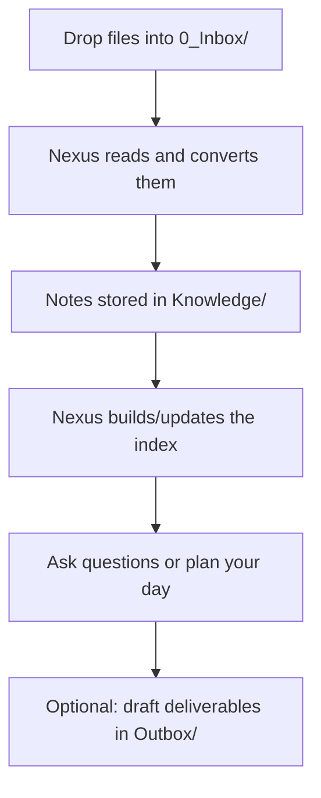
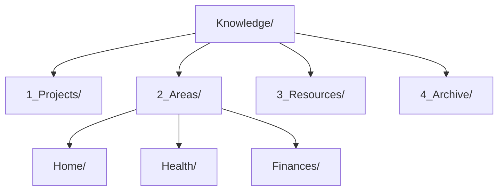

# Nexus AI — Introduction

Nexus is a personal assistant that helps you stay organized by turning your everyday files and notes into a searchable, time-aware knowledge base. It runs on your computer, keeps your information in a format you can always read, and helps you decide what to do next.

## What Nexus Is (In Plain English)
Think of Nexus as three things working together:
- A **library** for your documents (organized, searchable, durable)
- A **planner** for tasks, deadlines, and upcoming events (time-aware)
- A **helper** that answers questions based on your own information (plus optional web research)

## What Makes Nexus Different
Most AI productivity tools are effectively **read-only**: they can chat about your information, but they don’t maintain a durable system that stays organized over time.

Nexus is built around a **persistent knowledge base**:
- It keeps a living `Knowledge/` library that updates as you add new information.
- It can **reorganize** your knowledge when you ask (moves are tracked and reversible).
- It can **create new knowledge** (new notes, checklists, plans) as a natural outcome of using it.

This is the difference between “AI chat about my stuff” and “an assistant that helps maintain my life system.”

## The Big Idea: “Territory” vs “Map”
Nexus keeps your information in two layers:
- **Territory (what you own):** Markdown files in your `Knowledge/` folder
- **Map (what Nexus builds):** a fast index (database) that helps Nexus find the right parts of your knowledge quickly

```mermaid
flowchart LR
    K[Knowledge/ (Markdown you can read)] -->|indexed into| M[Local search index (database)]
    M -->|retrieval| A[Answers + plans]
    A -->|creates/edits| K
```

Why this matters:
- If Nexus breaks, your notes are still there, readable.
- The “map” can be rebuilt anytime from your notes.

## What Nexus Does (High Level)
- Converts documents into clean, readable notes
- Organizes notes in a simple folder system
- Finds tasks and deadlines inside notes
- Answers questions using your own information
- Suggests “today / this week / this month” plans
- Creates polished deliverables (draft emails, itineraries, call scripts) in an Outbox for review

## How It Works (Simple Flow)


## The Main Processes (What You’ll Actually Do)

### 1) Capture: Put Things In
You add:
- PDFs, images, and docs (receipts, contracts, letters)
- Notes you write yourself

Nexus can ingest these into your knowledge base without you manually rewriting everything.

### 2) Organize: Keep It Understandable
Nexus uses a simple top-level structure called PARA:
- **Projects**: things with an outcome + an end
- **Areas**: ongoing responsibilities (home, health, finances)
- **Resources**: reference material and general notes
- **Archive**: completed/inactive material

Under PARA, you can create any subfolders you want (e.g., `Taxes/`, `Real_Estate/`, `People/`). Nexus can also reorganize when you tell it to (“Create a tax folder and organize by year”).



### 3) Extract: Turn Notes Into Actions (Without Extra Work)
If your notes contain tasks in plain Markdown, Nexus will find them:

```md
- [ ] File taxes due:2026-04-15 p:P1
- [ ] Repaint door p:P2 effort:2h
```

Nexus uses this to answer “What should I do today/this week?” and to surface what’s overdue or urgent.

### 4) Plan: “What Should I Do Next?”
Nexus can produce:
- A prioritized list for today / this week / this month
- A draft schedule (time blocks) **only** when it has enough information (calendar integration or you tell it your availability)

If it’s missing key information, Nexus should ask a short question rather than guessing silently.

### 5) Deliver: Draft Real Outputs (Outbox)
Outbox is for ready-to-use artifacts like:
- Draft emails
- Meeting/call scripts (“what to say on the call”)
- Travel itineraries
- Calendar invites

```mermaid
flowchart LR
    Q[You ask for something] --> N[Nexus drafts deliverable]
    N --> O[Outbox/ (review)]
    O -->|approve| U[Use/send it]
    O -->|delete| D[Discard]
```

## What Questions Can Nexus Answer?
Examples:
- “What should I do today?”
- “What deadlines do I have this week?”
- “What did the contract say about renewal terms?”
- “Summarize the key points from my HOA letter.”
- “Where is the receipt for the roof repair?”

## Privacy and Safety (What to Expect)
- Your knowledge lives as files you own (`Knowledge/`).
- Integrations (calendar/email/etc.) should start **read-only** by default.
- When Nexus drafts outbound actions, it stages them in `Outbox/` for review.

## Where Your Data Lives (At a Glance)
Nexus uses a simple workspace folder:
- `0_Inbox/` — where new files go
- `Source/` — originals preserved
- `Knowledge/` — your readable notes (the “territory”)
- `.assistant/` — the index/database and settings (the “map”)
- `Outbox/` — drafts and deliverables waiting for review
- `Archive/` — processed originals

## Optional Tools and Integrations
Nexus is designed to plug into other systems when you want:
- Calendars (e.g., Google Calendar or imported `.ics` files)
- Email and contacts
- Task systems
- Web research for public facts (like standard deadlines), which Nexus can then save back into your knowledge base with sources

## What Nexus Is Not (Yet)
To keep the first version simple:
- Nexus starts as a **command-line tool** (a web app can come later).
- Nexus does not need you to perfectly tag everything; the folder structure usually does most of the organizing.

---

If you want to go deeper, see `README.md`, `Design.md`, and `REQUIREMENTS.md`.
